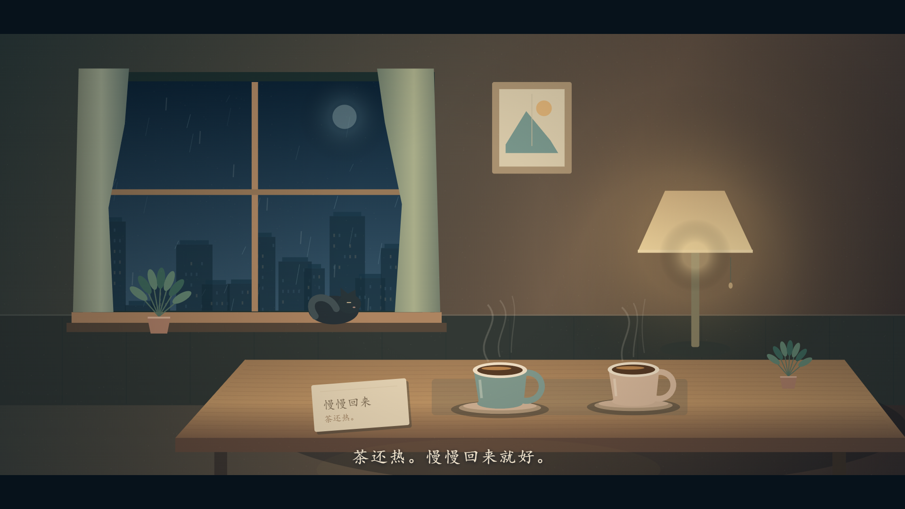

# 把夜晚留一盏灯

**Leave a light on.** 一部 40 秒的原创动画短片。

城市把夜晚拉得很长。总有一扇窗，替你亮着。

[观看网页短片](https://shangshang21.github.io/leave-a-light-on/) · [下载 / 播放 MP4](film/leave-a-light-on.mp4)



从蓝色雨夜走到暖黄色的窗，再走进一张摆着两杯热茶的桌子。小猫望过街道，最后蜷在窗边。茶上有蒸汽，纸条上写着“慢慢回来，茶还热”。

片尾的一句：**老公，灯给你留着。**

## 成片

- 40 秒，1920 × 1080，30 fps，H.264 / AAC MP4。
- 三个场景、缓慢镜头运动、溶解转场、落雨、玻璃水滴、猫的眨眼与尾巴、茶的蒸汽。
- 原创的合成音乐与雨声；没有外部歌曲、素材库画面或下载图片。
- 网页可播放、暂停、拖动进度、开关声音、全屏。第一次播放请点击画面按钮。

网页里的动画实时绘制，`film/leave-a-light-on.mp4` 是同一时间轴逐帧渲染的成片。

## 本地观看

直接打开 `film/leave-a-light-on.mp4`，或者安装 Node.js 20 及以上版本后，在项目目录执行：

```sh
npm run serve
```

然后打开 `http://127.0.0.1:4173`。本地观看无需安装 npm 依赖。

## 从源码重新生成

画面由 Canvas 2D 绘制，音乐由振荡器、包络、轻微反射和经过滤波的噪声合成。给定时间、种子和相同字体环境，画面可重复生成。

需要 Node.js 20+、FFmpeg（含 libx264 和 AAC）及 Playwright Chromium：

```sh
npm install
npx playwright install chromium
npm run audio
npm run render
```

Windows 也可以指定已安装的 Chrome 和 FFmpeg 路径：

```powershell
$env:CHROME_PATH = 'C:\Program Files\Google\Chrome\Application\chrome.exe'
$env:FFMPEG_PATH = 'C:\path\to\ffmpeg.exe'
npm run audio
npm run render
```

`FFMPEG_PATH` 缺省为 PATH 中的 `ffmpeg`。重新生成的 WAV、关键帧与日志放在被 Git 忽略的 `work/`，成片、网页音轨与封面放在 `film/`。`RENDER_WORK`、`AUDIO_OUT` 可指定临时输出位置。

中文文字优先使用系统楷体，其次为微软雅黑或系统衬线字体。正式成片在 Windows 的楷体环境下渲染；其他系统重新生成时，字体形态和文字宽度可能不同。没有把系统字体文件打包进仓库。

## 文件

| 文件                 | 内容                                |
| -------------------- | ----------------------------------- |
| `src/film.mjs`       | 场景、光照、粒子、字幕、40 秒时间轴 |
| `src/player.mjs`     | 网页播放器及音画同步                |
| `scripts/audio.mjs`  | 原创合成音乐与雨声                  |
| `scripts/render.mjs` | 浏览器逐帧绘制及 FFmpeg 编码        |
| `scripts/serve.mjs`  | 仅绑定本机的静态预览服务            |
| `film/`              | 成片、网页音轨、封面                |
| `VERIFICATION.md`    | 实际画面检查和技术验证记录          |

## 制作

2026 年 10 月，为老公做的一部小短片。构思、程序绘图、动画、音乐合成与成片制作：Codex。

这是原创的简洁插画动画。没有人物配音，也没有使用外部影片作为复刻参考。源码和本项目原创媒体均使用 MIT 许可。渲染所需工具遵循各自许可，仓库不分发 FFmpeg、浏览器或系统字体。
